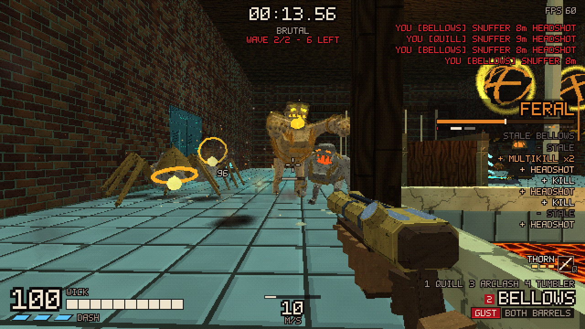
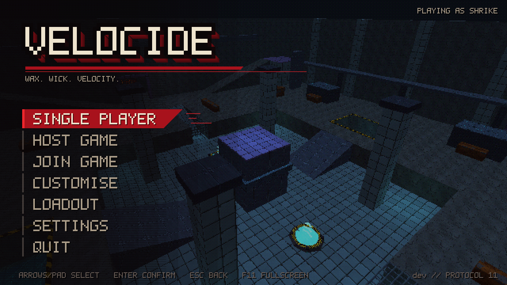
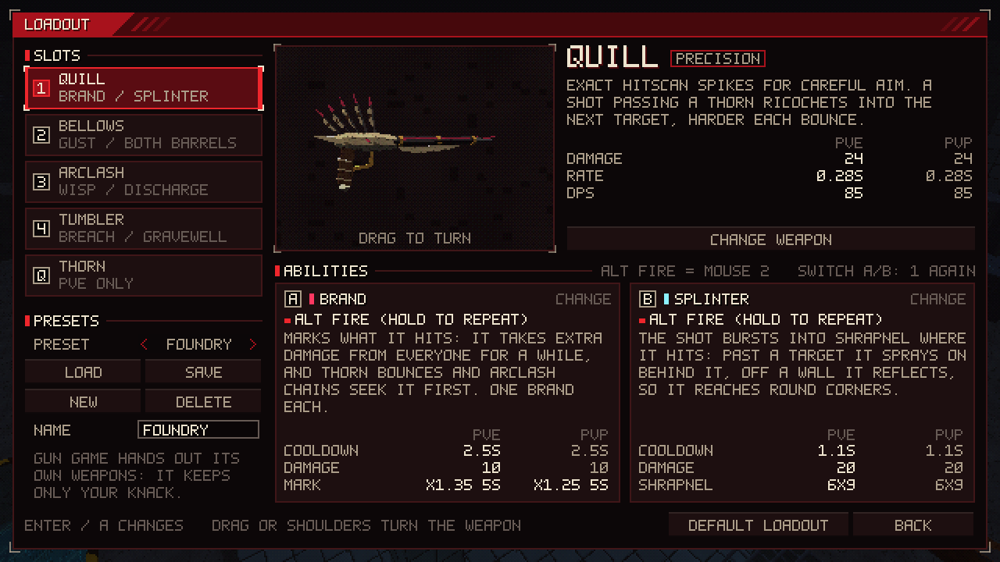
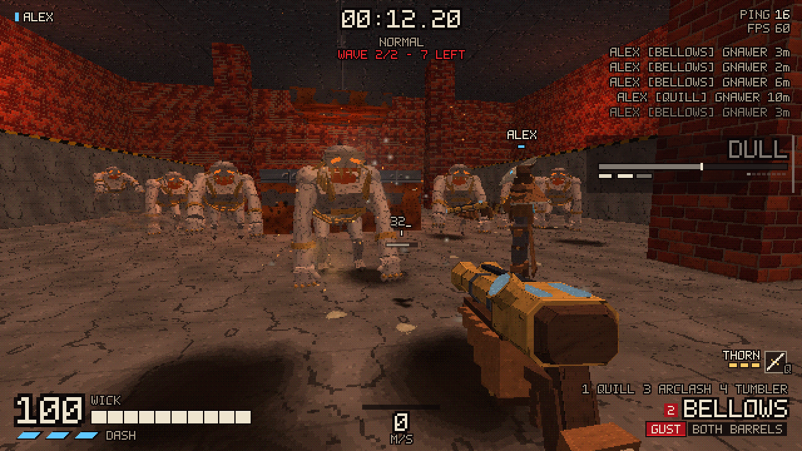
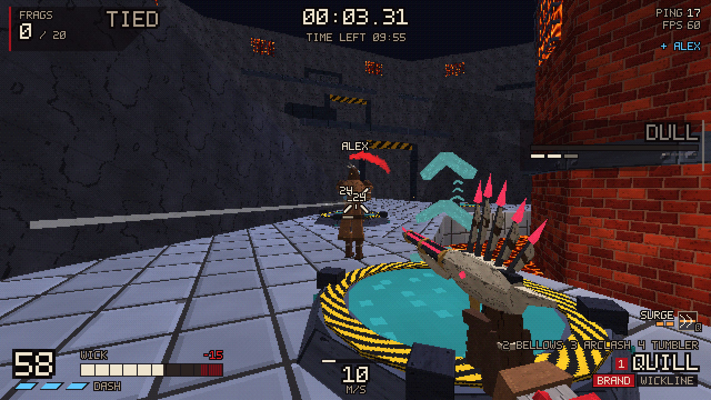
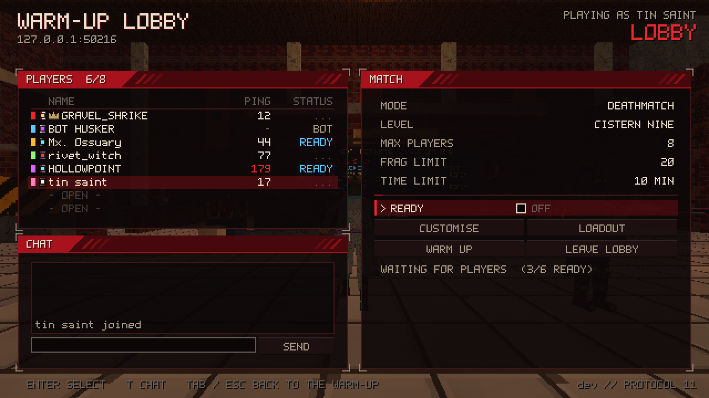
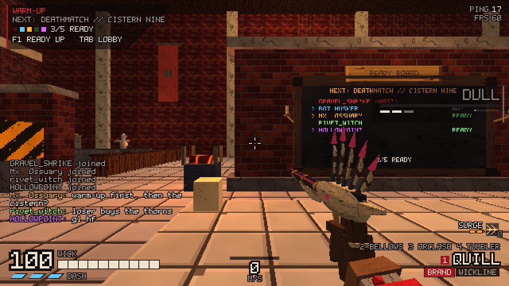
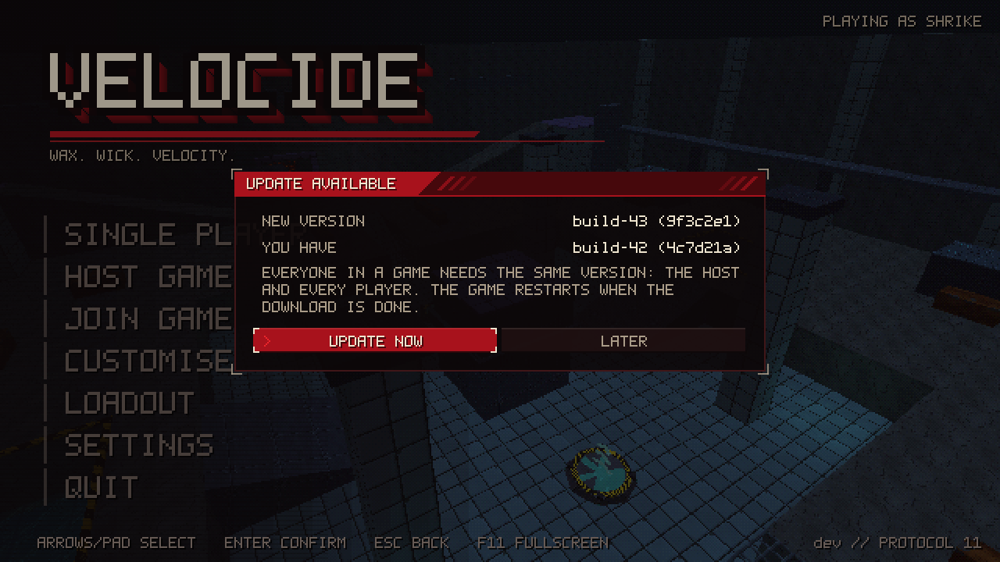
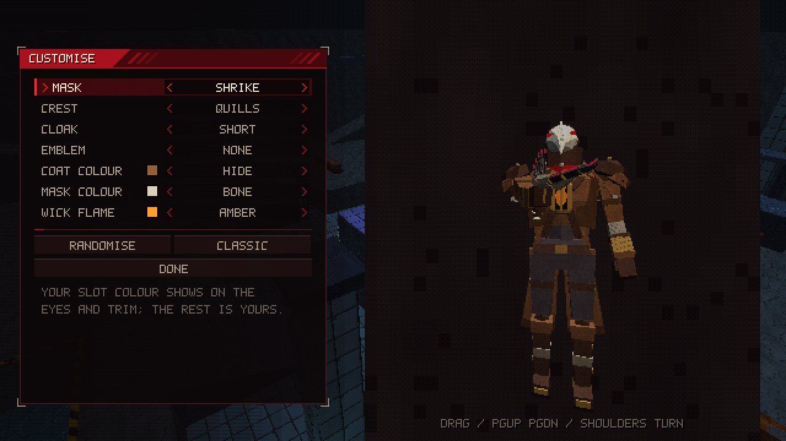
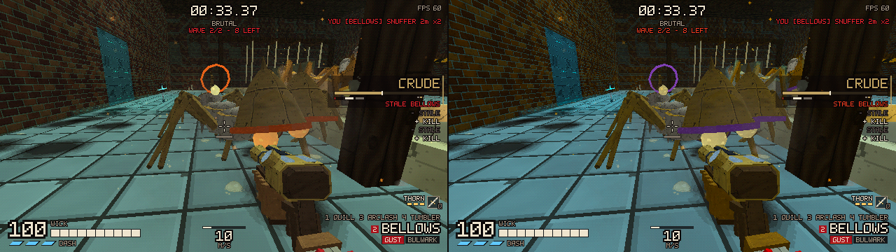

# VELOCIDE

A fast, style-driven retro multiplayer FPS on a small custom Rust engine. The Foundry never
stopped pouring: every scrap of heat left in the world has been cast into its wax-and-slag
*Moulds*. You play a *Shrike*, a masked hunter whose life is a flame burning in a lantern in its
chest, fast enough to tear that heat back out of them up close.

You can play single-player or online co-op (2–4 players) through the campaign levels **Crucible
of Veins**, **Spire of Wicks** and **The Drowned Chandlery**, survive endless waves together in
**Grind**, or fight each other (up to 8 players) in **Deathmatch** and **Gun Game** on the arenas
**Cistern Nine**, **Knell Yard**, **Ingot Run**, **Tallow Works**, **Wickmarket** and **Furnace
Ring**. Pick your own loadout of guns, melee weapons, abilities and a knack, and your Shrike's look. Everything is
original and procedural: the art, models, sound effects and music are all generated in code.

## Made with AI

VELOCIDE is an experiment with Claude (Anthropic's AI model) and agentic coding. Samuel
Skinner set the brief, directed the work, play-tested the builds and decided what changed
next. Claude, working in Claude Code, produced almost everything else: the design (the world,
the weapons, the Moulds), the engine and game code (on open-source Rust crates such as wgpu,
kira and renet), the 3D models and textures, the sound effects and music, the levels, the tests
and the docs, this README included. Most of it was built by several Claude agents at once: a
lead agent split each round of changes into areas with a written contract (the latest is
`docs/rework.md`), one agent per area worked in its own git worktree, and the lead merged them.

No AI image, audio or 3D-model generator was used: the models are built from code
(`docs/models.md`), the sounds and music are synthesised when the game starts
(`docs/audio.md`) and the levels are generated by `client/examples/level_gen.rs`.

## Screenshots

The game renders these itself (`scripts/readme_shots.sh`): real matches on real servers, with
the players steered by a script and dev commands such as `/god` and `/encounter`.



A wave in the Dipping Hall of The Drowned Chandlery, single-player on Brutal.

 

The main menu, and the loadout: the selected weapon turns in 3D beside its PvE and PvP
numbers, with its two abilities explained underneath.

 

Campaign co-op in Crucible of Veins, a teammate in the middle of a Gnawer pack, and a
deathmatch on Furnace Ring.

 

The warm-up while everyone joins: the lobby panel (Tab) and the Vestry with its ready board.

## Build and run

You need Rust 1.95 or newer (`rustup update`), a Vulkan, Metal or DX12 capable GPU, and on Linux
the ALSA and udev development packages (Fedora: `sudo dnf install alsa-lib-devel systemd-devel`;
Debian/Ubuntu: `sudo apt install libasound2-dev libudev-dev`).

```sh
cargo run -p client --release                          # main menu
cargo run -p client --release -- --sp crucible_of_veins   # straight into single-player
```

Use `--release`; debug builds work but run slower. The binary is `target/release/velocide`.

## Playing with friends

**Hosting from the game:** go to *Host Game* in the main menu, pick the mode (Campaign co-op,
Grind, Deathmatch or Gun Game), the level and, for co-op modes, the difficulty, then start. You
land in the **warm-up**: the Vestry, a hall with a movement course, a firing range of training
Effigies and a console that summons practice packs of Moulds. Run around while everyone joins.
Tab opens the lobby panel (players, chat, match settings, Customise, Loadout); it shows the
address friends should use, such as `192.168.1.20:47420`. F1 readies you up. When everyone is
ready, the host presses *Start*; after the match everyone comes back to the warm-up.

**Joining:** go to *Join Game*, type the host's `ip:port`, and you'll arrive in their lobby. You
can also join a match that is already running.

From the command line:

```sh
velocide --host 47420 --name Sam                 # host (listen server)
velocide --connect 203.0.113.7:47420 --name Alex # join
```

**Over the internet**, the host must make the UDP port reachable:

- Forward **UDP 47420** (or your chosen port) on the router to the host's PC.
- Open it in the host's firewall. On Fedora: `sudo firewall-cmd --add-port=47420/udp`.
  Add `--permanent` to keep the rule after a reboot.
- Alternatively, everyone can join a virtual LAN tool (any mesh VPN). Then use the host's VPN IP
  and no port forwarding is needed.

**Dedicated server** (step-by-step for a VPS such as a DigitalOcean droplet: `docs/hosting.md`) (headless, no player needed on the host machine):

```sh
cargo run -p server --release --bin velocide-server -- --port 47420 --mode deathmatch --level cistern_nine
cargo run -p server --release --bin velocide-server -- --mode campaign --level crucible_of_veins --autostart
cargo run -p server --release --bin velocide-server -- --mode grind --level furnace_ring --difficulty hard
cargo run -p server --release --bin velocide-server -- --mode gungame --level wickmarket
```

Without the source code, download the server from a release instead
(`velocide-server-linux-x86_64` or `velocide-server-windows-x86_64.exe`, see below) and give it
the same flags.

Modes: `campaign`, `deathmatch`, `gungame`, `grind`. Difficulty (co-op modes): `easy`, `normal`,
`hard`, `brutal`, `inferno`. `--no-warmup` keeps players in a menu-style lobby instead of the
Vestry.

On a dedicated server, the first player to join becomes the lobby host. With `--autostart`, the
match starts as soon as everyone is ready. Dev chat commands (`/god`, `/spawn`, `/tp`...) are
off on dedicated servers; `--dev-commands` turns them on for the lobby host only. In
single-player they are always available, and on a listen server only the host can use them.
`--help` lists every flag.

## Sharing the game with friends

Friends don't need the source code or any tools. Send them the link for their system:

- Windows: <https://github.com/SamSkinner01/velocide/releases/latest/download/velocide-windows-x86_64.exe>
- Linux: <https://github.com/SamSkinner01/velocide/releases/latest/download/velocide-linux-x86_64>

These always fetch the newest release from the
[Releases page](https://github.com/SamSkinner01/velocide/releases). The game is that one file,
with everything it needs built in: nothing to unpack, no folder to keep next to it. On Windows,
the first launch shows a SmartScreen warning because the exe isn't signed ("More info" → "Run
anyway"); on Linux, make the file executable first (`chmod +x velocide-linux-x86_64`). It runs
on any Linux distro with glibc 2.31 or newer, so about 2020 or newer. Each release also has a
`PLAY.txt` with the controls and how to host and join. There is no macOS build; it would have
to be built on a Mac.

Anyone who played an older version from a zip: put the new file in a folder of its own, or
delete the old `assets` folder. An `assets` folder next to the game still overrides the files
built into it (that is how development works), so an old one would bring back old levels and
models.

Everyone in a game, the server included, must run the same version (the release's name, such
as `build-42`). The game checks for a newer release when it starts and offers to update itself
from the main menu (`docs/distribution.md`), so friends download it by hand only once. The
version is shown bottom right on the main menu and in Settings → Gameplay, where *Check for
updates* turns the check off (as does `VELOCIDE_NO_UPDATE_CHECK=1`). If the game can't replace
itself (in a read-only folder, say), the prompt says why and opens the release page instead.
On Windows the replaced file stays as `<name>.exe.old` until the next launch deletes it.



The releases are made by CI: every push to `main` becomes a release `build-<n>`, and every `v*`
tag a release under its name, once fmt, clippy, the tests and both builds pass
(`.github/workflows/release.yml`, `docs/hosting.md` "Releases from CI"). Pull requests get the
same checks and builds, without a release.

To build the same files yourself:

```sh
scripts/package.sh            # or: scripts/package.sh linux / scripts/package.sh windows
```

The builds run in containers via podman or docker, so no extra toolchains are needed. The
output lands in `dist/`: `velocide-windows-x86_64.exe`, `velocide-linux-x86_64`, the dedicated
servers `velocide-server-windows-x86_64.exe` and `velocide-server-linux-x86_64`, and `PLAY.txt`.
Their version is the git commit (`-dirty` with uncommitted changes).

## Controls (rebindable in Settings → Controls)

| Action | Keyboard / mouse | Gamepad |
|---|---|---|
| Move | WASD | left stick |
| Look | mouse | right stick |
| Jump (wall jump in the air) | Space | A / South |
| Slide (ground) / Slam (air) | Left Ctrl or C | B / East |
| Dash (3 charges) | Left Shift | LB |
| Fire / Alt fire | LMB / RMB | RT / LT |
| Punch / **Parry** | F | RB |
| Knack (your Q ability: Thorn, Kindle Flask, Snare, Soot Pot, Tallow Skin, Surge) | Q | Y / North |
| Use / revive a teammate | E | X / West |
| Weapon slots (your loadout) | 1–4 (press again to switch between the build's two abilities) | D-pad |
| Next / previous weapon | mouse wheel | D-pad right / left |
| Cycle fire mode | middle mouse | D-pad up |
| Scoreboard (warm-up: lobby panel) | Tab | Select |
| Ready up (warm-up) | F1 | D-pad down |
| Chat | T or Enter | |
| Pause | Esc | Start |
| Restart (solo) | R | |
| Debug overlay | F3 | |
| Fullscreen | F11 | |

### How to play

- **Never stop moving.**
  - Sliding keeps your speed indefinitely on flat ground.
  - Slide-jumps and dash-jumps carry momentum.
  - Slam (crouch in the air) and jump right after landing to bounce much higher.
  - You get 3 wall jumps before you have to touch the ground again.
- **Heal by fighting up close.** Every hit you land knocks embers out of a Mould; the closest
  Shrike draws them into its wick (*kindling*). Part of each hit you take *smothers* your wick,
  temporarily capping your max health.
- **Parry.** Punch an incoming projectile just before it hits you (parryable ones wear a ring
  that tightens and strobes once they're in reach). It flies back at double damage and refills
  your wick. A Trimmer slash deflects them too. Punch a **Gaoler** while its shield rim strobes white-hot to
  stun it, or swat a diving **Harrier** out of the air.
- **Knacks** (Q). Pick one in the loadout:
  - *Thorn* (solo and co-op only; in PvP you carry Surge instead): a relay spike that plants
    itself in a wall or floor. Whatever reaches it (a shot, a pellet, a rocket, a blow) is
    relayed to the nearest enemy (branded ones first); chaining thorns multiplies the damage.
  - *Kindle Flask*: drink it for a few seconds of haste and healing.
  - *Snare*: a wax trap that pins and hurts the first enemy to step on it.
  - *Soot Pot*: a cloud Moulds can't see through.
  - *Tallow Skin*: take much less damage and no knockback for a few seconds.
  - *Surge*: a burst of speed along your look.
- **Style.** Mix weapons, kill in the air, parry and ricochet to climb the ranks from DULL up to
  VELOCIDE. Repeating the same weapon goes *stale* and earns less.

### Loadouts and builds

Choose your weapons in **Loadout** (main menu, lobby, pause menu, warm-up): up to four on the
slot keys 1–4, plus your **knack** on Q. Each weapon's base stats and primary fire are fixed;
you pick its **two abilities** (the alt fire) from the pool of its class. The screen shows the
selected weapon turning in 3D with its PvE and PvP numbers, and both abilities in boxes that
explain what they do and how to use them. Presets save whole loadouts. In a match a change
applies at your next respawn (at once in the warm-up). Gun game hands out its own weapons and
keeps your knack.

| class | weapons | ability pool |
|---|---|---|
| Precision | **Quill** (spike-caster), **Lancet** (rapid needle pistol), **Lamplighter** (lens rifle: hold to focus, release one beam) | Brand, Wickline, Tally, Waxwork |
| Scatter | **Bellows** (twin-barrel blast cannon), **Thresher** (drum-fed auto-scattergun) | Gust, Bolas, Bulwark, Flak |
| Rapid | **Arclash** (chaining arc caster), **Riveter** (hot-rivet driver), **Kiln** (ember sprayer, sets targets alight) | Wisp, Discharge, Stoke, Lantern |
| Explosive | **Tumbler** (bouncing bombs), **Cinderbox** (three-rocket salvo) | Breach, Gravewell, Limpet, Kite |
| Draw | **Longwick** (recurve bow: hold to draw, release to loose) | Brand, Blink Arrow, Pinning Arrow, Beacon Arrow |
| Melee | **Trimmer** (hooked wick-shears: fast slashes that also deflect projectiles), **Tamper** (foundry ramming hammer: slow, heavy, wide) | Lunge, Whirl, Hurl, Riposte |

Every pool holds a way to move, one to control or defend, one to set up and one to deal
damage. The abilities: *Brand* (the target takes extra damage from everyone), *Wickline* (a
thread that zips you to a surface or yanks a target to you), *Tally* (hold to mark targets,
release to shoot each one), *Waxwork* (a wax double the Moulds go for, then it bursts), *Gust*
(air blast that shoves enemies and turns projectiles around), *Bolas* (binds an enemy and ties
a second one to it: they share the hits), *Bulwark* (hold up a wax slab that soaks shots and
blows from the front), *Flak* (airbursts into a ring of pellets), *Wisp* (ball lightning that
orbits you; press again to fling it), *Discharge* (charged shock nova), *Stoke* (fire faster
and set things alight, then overheat), *Lantern* (a lantern that fires your weapon at the
nearest enemy), *Breach* (point-blank blast-jump), *Gravewell* (pulls enemies in, implodes),
*Limpet* (sticky charges: tap to throw, hold to detonate), *Kite* (an ember kite you steer with
your crosshair), *Blink Arrow* (step to your arrow), *Pinning Arrow* (pins enemies, slows
players), *Beacon Arrow* (reveals what's near it; they take more damage), *Lunge* (a low leap
that strikes the first thing you reach), *Whirl* (a spin that hits everything around you),
*Hurl* (throws a spinning blade or hammer head that comes back), *Riposte* (guard, then counter
what you blocked). **Burn** stacks damage over time; **Pinned** roots a Mould for a moment.

PvP and PvE are balanced separately for every weapon and ability (`docs/arsenal.md`,
`docs/balance.md`): in PvP a skilled player kills in about 0.8–1.8 s, and only a fully drawn
bow or a fully focused Lamplighter to the head, or a point-blank Bellows blast, kills in one
hit.
`cargo run -p shared --release --example balance_report` prints every weapon's damage, DPS and
time to kill against each Mould and a PvP player, and what every ability does in a fight,
measured in the real simulation.

### The Moulds

| Enemy | What it does | How to beat it |
|---|---|---|
| **Gnawer** | knuckle-walking pack hunter; bites, pounces at runners | head is big and low |
| **Censer** | brazier-headed lobber; 3 arcing ember bombs, swings at rushers | punch the embers back; shoot the brazier |
| **Harrier** | wax-winged flyer that dives at you | dodge sideways, or punch it mid-dive |
| **Gaoler** | 3.7 m jailer with a cell-door shield | parry the bash, jump the chain sweep, hit the lantern on its back |
| **Heron** | stilt-legged sniper; red aim laser locks white-hot just before it fires | dash out of the laser after it locks; its lens is high above cover |
| **Bellwether** | hangs back and rings its bell: nearby Moulds are frenzied (faster, harder-hitting) | hunt it down; shoot the bell during the wind-up to stagger it |
| **Snuffer** | leaps onto you and smothers your wick until you get it off | punch it off (or dash, or pin it) |
| **Smelter** | slow heavy that pours molten slag lines along the floor | step off the glowing line before it ignites; hit the crucible hatch |

Moulds are drawn big and their hit shapes reach past the model, so your shots land when they
look like they should. Any Mould can come as an **elite** (more health, faster attacks, a searing glow). The Vestry's
**Effigies** are training dummies: they show your hits and never die.

Moulds come after you: they leap gaps, ledges and deep water (a crouch, then the leap), ride
jump pads, pace the edge when they can't reach you, and one stranded for a few seconds melts
into a wax puddle and rises out of a new one near you. Water and lava still kill them: knock
them in.

### Modes

- **Campaign** (1–4 players): Crucible of Veins, Spire of Wicks, The Drowned Chandlery.
- **Grind** (1–4 players, any arena): endless waves that grow and bring tougher Moulds; every
  5th wave is heavy, every 10th has a boss elite. Fallen players return at the next wave; the
  run ends when everyone is down at once. Your best wave per arena and difficulty is saved.
- **Spectating** (co-op): while you're down or out, watch a teammate through their eyes (Jump:
  chase camera; Fire / Alt fire: next / previous teammate).
- **Difficulty** (campaign and grind): Easy, Normal, Hard, Brutal, Inferno. On top of it the
  Moulds scale with the number of players (more of them, tougher and more aggressive).
- **Deathmatch** (2–8 players): frags with a frag and time limit.
- **Gun Game** (2–8 players): every kill with your current weapon moves you up a ladder of all
  ten guns; the final tier is the **Trimmer**, and a kill with it wins. Getting punched knocks
  you down a tier.
- **Play of the game** (PvP modes): when the match ends, everyone watches the best highlight
  replayed from that player's eyes before the results. The kill feed shows each kill's distance.

## Settings

Settings are saved to `~/.config/velocide/settings.ron`. They include every retro effect
(internal resolution, vertex wobble, affine textures, dithering, colour depth, fog, vertex
lighting), screen shake, flashes, hitstop, FOV, sensitivity, volumes and key bindings.

**Customise** (main menu or lobby) sets your Shrike's mask, crest, cloak, emblem, colours and
wick flame, with a turning preview; everyone sees it. **Loadout** is described above.



**Accessibility** (Settings → Accessibility): a colour-vision mode for protanopia,
deuteranopia or tritanopia with a strength slider. It corrects the 3D view, switches the HUD,
team colours, enemy wind-ups, the parry window, the Heron's laser and enemy projectiles to a
palette that stays distinguishable, and adds shape cues (player marker shapes, a "!" diamond
over parryable enemies, +/− health popups).



The same moment in the standard look and in the deuteranopia mode.

## For developers

- **Code and design:** read `DESIGN.md`, plus `docs/*.md` for each subsystem.
- **Tuning while running:** gameplay numbers live in `assets/tuning.ron` (built into release
  binaries; a file on disk overrides the built-in one), which is watched while the game runs. Edit and save it, and the server reloads it and sends it to every client. The
  F3 overlay has an in-game editor for the movement values.
- **F3 overlay:** FPS, ping, packet loss, bandwidth, prediction corrections, and a "ghost"
  outline of where the server thinks you are.
- **Simulated lag:** `--netsim 100,20,2` adds 100 ms one-way latency, ±20 ms jitter and 2 %
  packet loss.
- **Local multiplayer test:** `scripts/local_test.sh --netsim 100,20,2` starts a dedicated
  server plus two clients with one command.
- **Dev chat commands** (in a match; in hosted games only the host can use them):
  `/spawn gnawer 5`, `/spawn gaoler 1 elite`, `/enemies`, `/god`, `/give`, `/killall`, `/melt`,
  `/loadout longwick:pinning,ember kiln trimmer knack:snare`, `/needle` or `/ember` (parry practice),
  `/encounter 1`, `/goto exit`, `/goto checkpoint 3`, `/tp x y z`, `/help`.
- **Screenshots:** `scripts/readme_shots.sh` renders the images in this README again
  (`docs/images/`; it says what it needs and how to pick other frames).
- **Tests:** `cargo test --workspace`. Lint: `cargo clippy --workspace --all-targets`, which
  must stay at zero warnings. CI runs both, and `cargo fmt --check`, on every pull request and
  push to `main`.

## Online play

Hosting from your own PC needs no port forwarding: **Host Game** with *Online: Join code*
shows a code like `ABCD-EFGH` in the lobby, and friends type it under **Join Game** (or find
*Public* games under **Browse games**). A small online service introduces the two PCs so they
connect directly, and relays the game when they can't; *Hide my IP* always uses the relay.
How it works, its security model and how CI deploys it to a VPS: `docs/rendezvous.md`.
